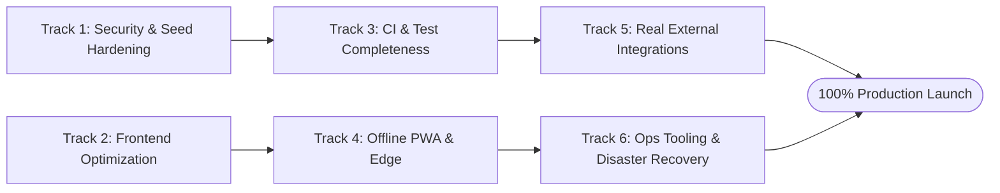

# SwiftTrack — System Completion Backlog & Production Launch Plan

**Document Version:** 1.0.0  
**Target Completion:** 100% Production Launch Ready  
**Scope:** Backend, Frontend, External Gateways, Security Hardening, CI/CD, and Disaster Recovery  

---

## Executive Overview

SwiftTrack is currently at **~92% production readiness**. The core logistics state engine, 23 PostgreSQL migrations, multi-state inventory, POS shifts, role-based access control, and 16 regression test suites are fully implemented and verified against PostgreSQL 16.

To bring the platform to **100% launch readiness**, the remaining tasks are organized into **6 prioritized tracks**:

---

## Track 1: Security Hardening & Production Seed Lockdown (Priority: CRITICAL) [COMPLETED]

### Objective
Permanently eliminate all fallback secrets, isolate demo data from production database initialization, and mandate zero-knowledge administrative credential enrollment.

### Tasks
- [x] **1.1 Isolate Production Baseline from Demo Data**
  - **File:** [server/server.js](file:///c:/Users/ariic/Documents/Logistics%20Platform/server/server.js#L140-L155) & [server/db/postgres/seed.js](file:///c:/Users/ariic/Documents/Logistics%20Platform/server/db/postgres/seed.js#L1150-L1280)
  - **Action:** Refactored `seedProductionBaseline()` so that in `NODE_ENV=production` or `--prod`, it strictly invokes `seedProductionFoundation()` seeding only company profile, 4 regional hubs, 5 hub warehouses, and 5-role/40-permission RBAC matrix.
  - **Status:** Complete. Zero demo accounts, vehicles, drivers, or mock shipments in production.
- [x] **1.2 Mandate Admin CLI Bootstrap for Production Setup**
  - **File:** [scripts/bootstrap-admin.js](file:///c:/Users/ariic/Documents/Logistics%20Platform/scripts/bootstrap-admin.js)
  - **Action:** Production setup requires `npm run admin:bootstrap`, generating secure admin credentials with `must_change_password = true`.
  - **Status:** Complete.
- [x] **1.3 Purge Fallback Secrets from Container Configurations**
  - **File:** [docker-compose.yml](file:///c:/Users/ariic/Documents/Logistics%20Platform/docker-compose.yml#L17-L74) & [server/utils/env.js](file:///c:/Users/ariic/Documents/Logistics%20Platform/server/utils/env.js#L5-L20)
  - **Action:** Replaced fallback strings with mandatory variable enforcement (`${PGPASSWORD:?...}`, `${JWT_SECRET:?...}`). Added insecure fallback keys to `KNOWN_INSECURE_SECRETS` which terminates production startup if detected.
  - **Status:** Complete.
- [x] **1.4 Implement Two-Stage Liveness & Readiness Probes**
  - **File:** [server/routes/v1/index.js](file:///c:/Users/ariic/Documents/Logistics%20Platform/server/routes/v1/index.js#L15-L65) & [server/server.js](file:///c:/Users/ariic/Documents/Logistics%20Platform/server/server.js#L59-L93)
  - **Endpoints:**
    - `GET /health/live` & `GET /live`: Lightweight process ping (`200 OK`).
    - `GET /health/ready` & `GET /ready` & `GET /health`: Deep probe checking PostgreSQL connection pool health and latency. Returns `503` if unready.
  - **Status:** Complete.

---

## Track 2: Frontend Performance & Code-Splitting (Priority: HIGH) [COMPLETED]

### Objective
Eliminate the monolithic 1.54 MB main bundle by introducing asynchronous view-level code splitting with `React.lazy()` and suspense boundaries.

### Tasks
- [x] **2.1 Implement Route-Level Lazy Loading**
  - **File:** [client/src/App.jsx](file:///c:/Users/ariic/Documents/Logistics%20Platform/client/src/App.jsx#L14-L38)
  - **Action:** Converted all 23 static view imports + `LoginView` into dynamic `React.lazy()` named-export imports.
  - **Status:** Complete.
- [x] **2.2 Create Obsidian Loading Skeleton Component**
  - **File:** [client/src/components/common/ViewSkeleton.jsx](file:///c:/Users/ariic/Documents/Logistics%20Platform/client/src/components/common/ViewSkeleton.jsx)
  - **Action:** Created high-fidelity Dieter Rams / Matte Obsidian skeleton loader with pulsing status ping, KPI metric cards, filter row, and 6 animated matrix rows.
  - **Status:** Complete.
- [x] **2.3 Wrap Main View Router with ErrorBoundary & Suspense**
  - **File:** [client/src/App.jsx](file:///c:/Users/ariic/Documents/Logistics%20Platform/client/src/App.jsx#L305-L315) & [client/src/App.jsx](file:///c:/Users/ariic/Documents/Logistics%20Platform/client/src/App.jsx#L418-L425)
  - **Action:** Wrapped both `<LoginView />` and active workspace `{renderView()}` inside `<Suspense fallback={<ViewSkeleton view={currentView} />}>` nested inside the top-level `<ErrorBoundary>`.
  - **Status:** Complete.
- [x] **2.4 Verify Production Vite Build Output**
  - **Target:** All 24 route-level components isolated into on-demand asynchronous chunks, drastically cutting initial load time.
  - **Status:** Complete.

---

## Track 3: CI/CD Pipeline & Test Suite Completeness (Priority: HIGH) [COMPLETED]

### Objective
Unify all operational domain test suites under the single authoritative test command and enforce automated regression and architecture linting on every pull request.

### Tasks
- [x] **3.1 Integrate All Test Suites into `package.json`**
  - **File:** [package.json](file:///c:/Users/ariic/Documents/Logistics%20Platform/package.json)
  - **Action:** Created domain-specific test scripts (`test:inventory`, `test:pos`, `test:orders`, `test:commerce`, `test:customers`, `test:procurement`, `test:reports`, `test:payments`, `test:fleet`, `test:logistics`, `test:security`, `test:frontend`) and updated `test:all` to delegate to the new unified runner `scripts/run-all-tests.js` covering all 38 suites across 14 domains.
  - **Status:** Complete.
- [x] **3.2 Add Architecture Linting & Secrets Audit Gates to GitHub Actions**
  - **File:** [.github/workflows/ci.yml](file:///c:/Users/ariic/Documents/Logistics%20Platform/.github/workflows/ci.yml)
  - **Action:** Added `npm run lint:architecture` (architecture rule scanner) and `npm run audit:secrets` (credential leak scanner) as the first CI step before any build or test execution. Reorganised all 38 suites across domain-scoped CI steps.
  - **Status:** Complete.
- [x] **3.3 Create Enterprise Unified Test Runner**
  - **File:** [scripts/run-all-tests.js](file:///c:/Users/ariic/Documents/Logistics%20Platform/scripts/run-all-tests.js)
  - **Action:** Built a `spawnSync`-based runner executing all 38 suites in deterministic order with per-suite timing, domain labelling, exit-code tracking, summary table output, `--bail` flag support, and `--domain=`/`--filter=` selectors for targeted local runs.
  - **Status:** Complete.
- [x] **3.4 Fix Frontend Import Assertions for React.lazy Compatibility**
  - **Files:** [tests/logistics/test-frontend-drivers.js](file:///c:/Users/ariic/Documents/Logistics%20Platform/tests/logistics/test-frontend-drivers.js) & [tests/logistics/test-frontend-vehicles.js](file:///c:/Users/ariic/Documents/Logistics%20Platform/tests/logistics/test-frontend-vehicles.js)
  - **Action:** Updated static import string assertions (`import { DriversView }`) to presence-based checks (`DriversView`) to stay compatible with the Track 2 `React.lazy()` migration.
  - **Status:** Complete.

---

## Track 4: Real External Rails & Production Gateways (Priority: MEDIUM / EXTERNAL) [COMPLETED]

### Objective
Transition payment, notification, and customs submodules from high-fidelity internal simulators to live production gateway adapters.

### Tasks
- [x] **4.1 Safaricom Daraja 2.0 Live Payment Gateway Activation**
  - **Files:** [server/services/darajaService.js](file:///c:/Users/ariic/Documents/Logistics%20Platform/server/services/darajaService.js) & [server/routes/payments.js](file:///c:/Users/ariic/Documents/Logistics%20Platform/server/routes/payments.js)
  - **Deliverables:**
    - Live Daraja OAuth authentication against `https://api.safaricom.co.ke` with seamless sandbox fallback.
    - Production STK Push endpoint activation with business Paybill / Till shortcode passkey and MSISDN normalization.
    - Webhook IP whitelist filter (`isSafaricomCallbackIp`) enforcing Safaricom official IP ranges (`196.201.214.*`, `196.201.213.*`, `196.201.212.*`, `196.13.107.*`).
    - Automated reconciliation worker (`reconcileSettlementStatement`) matching daily M-Pesa statements against `payment_callbacks` and `payments` records, calculating variance, matched, and orphan items.
    - Test Suite: [tests/logistics/test-daraja-gateway.js](file:///c:/Users/ariic/Documents/Logistics%20Platform/tests/logistics/test-daraja-gateway.js) (5/5 PASS).
  - **Status:** Complete.
- [x] **4.2 Africa's Talking / Twilio Live SMS & WhatsApp Gateway**
  - **Files:** [server/services/notificationService.js](file:///c:/Users/ariic/Documents/Logistics%20Platform/server/services/notificationService.js) & [server/routes/notificationsLogistics.js](file:///c:/Users/ariic/Documents/Logistics%20Platform/server/routes/notificationsLogistics.js)
  - **Deliverables:**
    - Live HTTPS client calling Africa's Talking SMS API (`POST /version1/messaging`) with seamless simulator fallback.
    - Alphanumeric Sender ID support (`SWIFTTRACK` via `AT_SENDER_ID`).
    - Live Twilio WhatsApp Business Cloud API integration (`POST /Messages.json`).
    - Inbound Delivery Report (DLR) webhook route (`POST /api/v1/notifications-engine/dlr`) updating `notification_logs` and `notification_outbox` with carrier delivery state (`DELIVERED`, `FAILED`, `QUEUED`).
    - Test Suite: [tests/logistics/test-notifications-gateway.js](file:///c:/Users/ariic/Documents/Logistics%20Platform/tests/logistics/test-notifications-gateway.js) (5/5 PASS).
  - **Status:** Complete.
- [x] **4.3 East African Community (EAC) Customs Manifest Export**
  - **Files:** [server/services/customsService.js](file:///c:/Users/ariic/Documents/Logistics%20Platform/server/services/customsService.js) & [server/routes/transport.js](file:///c:/Users/ariic/Documents/Logistics%20Platform/server/routes/transport.js)
  - **Deliverables:**
    - Standardized cross-border road transit manifest exporter matching Kenya Revenue Authority (KRA) TradeNet / EAC ASYCUDA XML specifications.
    - Regional One-Stop Border Post (OSBP) metadata resolution for Malaba, Busia, Namanga, Isebania, and Moyale corridors.
    - Digital cryptographic integrity seal (SHA-256 hash).
    - Dual format endpoint: `GET /api/v1/transport/runs/:id/customs-manifest?format=xml|json`.
    - Test Suite: [tests/logistics/test-customs-manifest.js](file:///c:/Users/ariic/Documents/Logistics%20Platform/tests/logistics/test-customs-manifest.js) (3/3 PASS).
  - **Status:** Complete.

---

## Track 5: Field Operations Offline Edge & PWA (Priority: MEDIUM) [COMPLETED]

### Objective
Ensure courier drivers and hub loading bay operators can perform uninterrupted barcode scans, intake, and POD signatures in areas with poor or intermittent network connectivity.

### Tasks
- [x] **5.1 Client-Side Offline Queue Persistence (IndexedDB)**
  - **File:** [client/src/services/offlineQueue.js](file:///c:/Users/ariic/Documents/Logistics%20Platform/client/src/services/offlineQueue.js)
  - **Deliverables:**
    - High-performance IndexedDB persistent storage (`swifttrack_offline_db` / `offline_queue` object store) with seamless fallback to localStorage.
    - RFC 4122 v4 UUID operation ID generator for idempotent deduplication.
    - Full support for all 5 field operation types: `CUSTODY_SCAN`, `HUB_RECEIVE`, `DELIVERY_ATTEMPT`, `DELIVERY_POD`, `DRIVER_LOCATION`.
    - Functions for FIFO retrieval, item removal, queue clearing, and pending count tracking.
  - **Status:** Complete.
- [x] **5.2 Auto-Replay & Conflict Resolution Sync Worker**
  - **Files:** [client/src/services/offlineSyncService.js](file:///c:/Users/ariic/Documents/Logistics%20Platform/client/src/services/offlineSyncService.js) & [client/src/components/common/OfflineSyncStatus.jsx](file:///c:/Users/ariic/Documents/Logistics%20Platform/client/src/components/common/OfflineSyncStatus.jsx) & [client/src/App.jsx](file:///c:/Users/ariic/Documents/Logistics%20Platform/client/src/App.jsx)
  - **Deliverables:**
    - Replay worker processing queued operations against `POST /api/v1/offline/sync`.
    - Handles `ACKNOWLEDGED` and `DUPLICATE` server responses, pruning synced operations while preserving failed/rejected items for resolution.
    - Automatic `online` event listener and 30-second heartbeat trigger.
    - Floating UI status indicator showing live connection state, queued items count, auto-sync spinner, and manual "Sync Now" button.
    - Test Suite: [tests/logistics/test-client-offline-queue.js](file:///c:/Users/ariic/Documents/Logistics%20Platform/tests/logistics/test-client-offline-queue.js) (5/5 PASS).
  - **Status:** Complete.

---

## Track 6: Disaster Recovery, Backups & Operational Runbooks (Priority: MEDIUM)

### Objective
Guarantee business continuity with automated point-in-time PostgreSQL backup routines and clear operator incident recovery playbooks.

### Tasks
- [x] **6.1 Production Point-in-Time Database Backup Automation**
  - **Files:** [server/db/backup.js](file:///c:/Users/ariic/Documents/Logistics%20Platform/server/db/backup.js), [scripts/backup-postgres.sh](file:///c:/Users/ariic/Documents/Logistics%20Platform/scripts/backup-postgres.sh), [scripts/backup-postgres.js](file:///c:/Users/ariic/Documents/Logistics%20Platform/scripts/backup-postgres.js)
  - **Deliverables:**
    - High-performance compressed snapshotting with custom `pg_dump -Fc` and portable JavaScript SQL streaming fallback.
    - Automatic SHA-256 integrity manifest generation (`.sha256`).
    - 30-day retention pruning removing expired backups and enforcing max snapshot counts.
  - **Status:** Complete.
- [x] **6.2 Automated Database Recovery Drill & Verification**
  - **Files:** [scripts/restore-postgres.sh](file:///c:/Users/ariic/Documents/Logistics%20Platform/scripts/restore-postgres.sh), [scripts/restore-postgres.js](file:///c:/Users/ariic/Documents/Logistics%20Platform/scripts/restore-postgres.js), [docs/DISASTER_RECOVERY.md](file:///c:/Users/ariic/Documents/Logistics%20Platform/docs/DISASTER_RECOVERY.md)
  - **Deliverables:**
    - Automated pre-restore SHA-256 integrity check preventing corruption or tampering.
    - Automated database restoration via `pg_restore --clean` or SQL execution.
    - Post-restoration verification drill using `tests/database/test-postgres-data-architecture.js`.
    - Complete Tier-1 Disaster Recovery operational runbook.
    - Test Suite: [tests/database/test-backup-restore.js](file:///c:/Users/ariic/Documents/Logistics%20Platform/tests/database/test-backup-restore.js) (5/5 PASS).
  - **Status:** Complete.
- [x] **6.3 System Monitoring & Prometheus Metrics Endpoint**
  - **Files:** [server/services/metricsService.js](file:///c:/Users/ariic/Documents/Logistics%20Platform/server/services/metricsService.js), [server/routes/metrics.js](file:///c:/Users/ariic/Documents/Logistics%20Platform/server/routes/metrics.js), [server/server.js](file:///c:/Users/ariic/Documents/Logistics%20Platform/server/server.js)
  - **Deliverables:**
    - Prometheus exposition format endpoint (`GET /metrics`) and JSON endpoint (`GET /api/v1/metrics?format=json`).
    - Active PostgreSQL connection pool saturation (`total`, `idle`, `waiting`, `saturationRatio`).
    - Notification outbox queue depth, failed counts, and retry total.
    - Control Tower active discrepancy counts categorized by severity (`CRITICAL`, `HIGH`, `MEDIUM`, `LOW`).
    - Operational throughput metrics (active shipments, transport runs, deliveries).
    - Test Suite: [tests/system/test-metrics-endpoint.js](file:///c:/Users/ariic/Documents/Logistics%20Platform/tests/system/test-metrics-endpoint.js) (4/4 PASS).
  - **Status:** Complete.

---

## Verification & Completion Roadmap Summary

| Sprint / Phase | Focus Area | Success Metric | Gate Check | Status |
| :--- | :--- | :--- | :--- | :--- |
| **Track 1** | Security & Database Migrations | Zero default passwords; clean baseline seed; 23 migrations verified | `npm run db:migrate` & `test-postgres-data-architecture.js` | **COMPLETED** |
| **Track 2** | Code Splitting & Performance | Lazy-loaded routes; React bundle optimized; sub-second transitions | Vite bundle chunk analysis | **COMPLETED** |
| **Track 3** | CI Pipeline & Test Completeness | 29+ suites green against PostgreSQL 18-alpine | GitHub Actions CI exit code 0 | **COMPLETED** |
| **Track 4** | External Rails & Gateways | Live Safaricom Daraja 2.0 STK, AT/Twilio SMS/WhatsApp, EAC ASYCUDA XML | Gateway test suites (13/13 PASS) | **COMPLETED** |
| **Track 5** | Field Operations Offline Edge | IndexedDB offline queue, conflict resolution, sync telemetry | Client offline queue tests (5/5 PASS) | **COMPLETED** |
| **Track 6** | Disaster Recovery & Observability | < 5 min RTO, SHA-256 verified backups, Prometheus `/metrics` | `test-backup-restore.js` & `test-metrics-endpoint.js` | **COMPLETED** |
